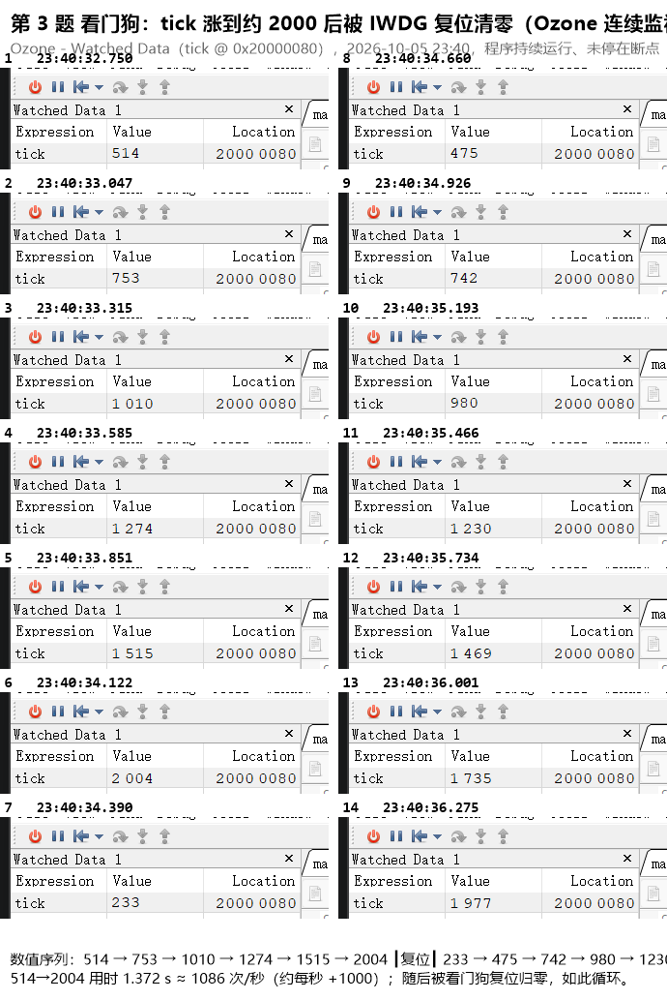

# 电控第一次作业 说明文档

| 项目 | 内容 |
| --- | --- |
| 姓名 | 李梦冉 |
| 学号 | 3260102029 |
| 组别 | 电控组 |
| 作业次数 | 第 1 次 |
| 板子 | F103 最小系统板（丝印 STM32F103C8Tx，LQFP48） |
| 日期 | 2026-10-04 |

> 说明：所有截图与照片只放在文末「附录」，正文中不插图。

---

## 一、工程与构建环境

### 1.1 工具链

| 工具 | 版本 / 路径 |
| --- | --- |
| STM32CubeMX | 6.18.1（固件包 STM32Cube FW_F1 V1.8.7） |
| CMake | D:\CMake\bin\cmake.exe |
| Ninja | D:\ninja\ninja.exe |
| arm-none-eabi-gcc | 11.3.rel1 |
| VS Code | CMake Tools，构建类型 **Debug** |
| SEGGER Ozone | V3.26（打开 `build/project.elf`） |

### 1.2 建立工程的过程

1. CubeMX 新建工程，芯片选 STM32F103C8Tx，**Toolchain/IDE 选 CMake，勾选 Generate Under Root**，生成代码。
2. 删掉 CubeMX 生成的 `CMakeLists.txt`，换成发放的模板，其中 `user_folders` 保持 `"Tasks"`。
3. 在工程根目录新建 `Tasks/inc` 与 `Tasks/src`，**之后**才执行 CMake Configure（目录不存在就 Configure，Tasks 不会进编译）。
4. `main.c` 里只在 USER CODE 段中包含 `tasks.h` 并调用 `Tasks_Init()`，`while (1)` 保持为空。
5. VS Code 里用 Debug 预设构建，产物为 `build/project.elf`；再用 Ozone 打开它。

### 1.3 工程目录结构

```
homework1/
├── Core/                  # CubeMX 生成的启动、外设初始化代码
│   ├── Inc/
│   └── Src/main.c         # 只在 USER CODE 里 #include "tasks.h" 并调用 Tasks_Init()
├── Drivers/               # STM32F1xx HAL 库
├── Tasks/                 # 业务代码只写在这里
│   ├── inc/tasks.h
│   └── src/task.c         # 三题的实现
├── cmake/                 # 交叉编译工具链文件等
├── CMakeLists.txt         # 发放的模板（user_folders = "Tasks"）
├── CMakePresets.json      # Debug / Release 预设
├── homework1.ioc          # CubeMX 工程文件
└── build/project.elf      # 构建产物，Ozone 打开的对象
```

### 1.4 三题的关键配置一览

| 题号 | 外设 | 配置 |
| --- | --- | --- |
| 1 GPIO | PC13 | 推挽输出，初始电平低 |
| 2 定时器 | TIM2 | 内部时钟，PSC = 7，ARR = 999，使能更新中断（NVIC） |
| 3 看门狗 | IWDG | 预分频 32，Reload = 2500，约 2 s 超时，第一题起一直启用 |

---

## 二、第 1 题 GPIO

### 2.1 CubeMX 配置

`PC13-TAMPER-RTC` 配置为 `GPIO_Output`，模式为推挽输出（Output Push Pull），无上下拉，初始电平 Low。

### 2.2 代码（`Tasks/src/task.c`）

```c
void Tasks_Init(void)
{
    /* ===== 第 1 题 GPIO =====
     * PC13 已在 CubeMX 里配成推挽输出，这里把它写成表中的电平：
     * 低电平 -> 最小系统板板载 LED 点亮。
     * 注意：只在这里写一次，不要在 while (1) 里翻转。 */
    HAL_GPIO_WritePin(GPIOC, GPIO_PIN_13, GPIO_PIN_RESET);

    /* 第 2 题的定时器启动，见下一节 */
    HAL_TIM_Base_Start_IT(&htim2);
}
```

`Tasks_Init()` 由 `main.c` 的 USER CODE 段在 `MX_GPIO_Init()` 之后调用：

```c
  MX_GPIO_Init();
  MX_IWDG_Init();
  MX_TIM2_Init();
  /* USER CODE BEGIN 2 */
  Tasks_Init();
  /* USER CODE END 2 */
```

### 2.3 现象

PC13 被拉低，F103 最小系统板的板载 LED（接在 PC13 与 3V3 之间，低电平点亮）**常亮**，`while (1)` 里没有任何翻转动作。

照片见 **附录 图 1**。

---

## 三、第 2 题 定时器

### 3.1 CubeMX 配置

* TIM2 时钟源：Internal Clock
* Prescaler（PSC）= **7**
* Counter Period（ARR）= **999**
* NVIC 中使能 `TIM2 global interrupt`

### 3.2 代码

全局变量 `tick`（必须是全局的 `volatile uint32_t`，Ozone 的 Watched Data 才能看到）：

```c
volatile uint32_t tick = 0;
```

在 `Tasks_Init()` 里启动定时器更新中断（漏掉这一句，`tick` 永远是 0）：

```c
HAL_TIM_Base_Start_IT(&htim2);
```

定时器更新回调，全工程只写这一份（放在 `Tasks` 里；CubeMX 若在 `main.c` 或中断文件里也生成了同名函数，要删掉那一份，否则链接报重复定义）：

```c
void HAL_TIM_PeriodElapsedCallback(TIM_HandleTypeDef *htim)
{
    if (htim->Instance == TIM2)
    {
        tick++;

        /* 第 2 题：取消下一行注释后再编译下载 */
        HAL_IWDG_Refresh(&hiwdg);
    }
}
```

> 第 2 题与第 3 题分两次下载、分两次截图，两题之间只差这一行 `HAL_IWDG_Refresh(&hiwdg);` 的注释与取消注释。
> 仓库中提交的是**第 3 题**的状态（该行被注释，即不喂狗），第 2 题截图时把它取消注释即可。

### 3.3 1 ms 周期的计算过程

**（1）定时器时钟从哪来**

CubeMX 的时钟树里：

* `SYSCLK Source` = **HSI**，未使用 PLL，因此 SYSCLK = **8 MHz**
* `AHB Prescaler` = 1 → HCLK = 8 MHz
* `APB1 Prescaler` = **1** → PCLK1 = 8 MHz
* CubeMX 时钟树显示的 `TimSysFreq_Value`（定时器时钟）= **8000000 Hz**

规则：定时器挂在 APB1 上，当 **APB1 预分频系数不为 1** 时，定时器时钟是 PCLK1 的 2 倍；当 APB1 分频为 1 时**不乘 2**。
本工程 APB1 分频为 1，所以：

```
TIM2 时钟频率 f = PCLK1 = 8 MHz = 8 000 000 Hz
```

**（2）PSC 与 ARR 的取值**

定时器更新中断周期：

```
T = (PSC + 1) × (ARR + 1) / f
```

要求 T = 1 ms = 0.001 s，取计数值 (ARR + 1) = 1000 ⇒ ARR = 999，则：

```
(PSC + 1) = T × f / (ARR + 1) = 0.001 × 8 000 000 / 1000 = 8
PSC = 7
```

验算：

```
(7 + 1) × (999 + 1) / 8 000 000 = 8000 / 8 000 000 = 0.001 s = 1 ms
```

因此 `tick` 每 1 ms 加 1，**每秒增加约 1000**。

> 备注：本工程没有使用外部晶振（HSE），所以按 8 MHz 计算。如果改用 HSE 8 MHz + PLL×9 = 72 MHz，那么定时器时钟为 72 MHz，同样的 1 ms 应取 **PSC = 71、ARR = 999**。以 CubeMX 时钟树实际显示的定时器时钟为准。

**（3）为什么不用 HAL_Delay 或空循环**

`HAL_Delay` 依赖 SysTick 中断并且是阻塞的，空循环的耗时又随编译优化等级变化，都无法保证 1 ms 的准确周期，也无法在 `while (1)` 为空的前提下持续累加。这里用定时器更新中断，由硬件分频得到严格 1 ms 的周期。

### 3.4 Ozone 观察

把 `tick` 加到 **Watched Data** 窗口，或打开 **Timeline** 观察 `tick` 曲线，程序保持**运行**状态（不要停在断点上），可以看到数值以约 1000/s 的斜率一直增加。

截图见 **附录 图 2**。

---

## 四、第 3 题 看门狗

### 4.1 CubeMX 配置

IWDG 从第 1 题起就启用，第 3 题不改变超时与分频：

* IWDG Prescaler = **32**
* IWDG Reload = **2500**

### 4.2 超时时间的计算过程

独立看门狗由 LSI 提供时钟，F103 的 LSI 手册典型值取 **40 kHz**：

```
超时 = (Reload + 1) × 分频 / LSI
     = (2500 + 1) × 32 / 40 000
     = 80 032 / 40 000
     ≈ 2.0008 s ≈ 2 s
```

约 2 s，明显长于 1 ms 的中断周期，所以 `tick` 来得及累加。

### 4.3 代码

与第 2 题唯一的区别：回调里**去掉** `HAL_IWDG_Refresh(&hiwdg);`，即不喂狗。

```c
void HAL_TIM_PeriodElapsedCallback(TIM_HandleTypeDef *htim)
{
    if (htim->Instance == TIM2)
    {
        tick++;
        /* 第 3 题：不喂狗，这一行保持注释 */
        // HAL_IWDG_Refresh(&hiwdg);
    }
}
```

重新编译、下载后观察。

### 4.4 预期现象

`tick` 从 0 开始以 1 ms 的步长增加，约 2 s 后增加到大约 **2000**，此时看门狗超时触发芯片复位；复位后启动代码把全局变量清零，`tick` 回到 **0**，如此不断重复。

回到 0 不是 `tick` 被清，而是**芯片复位后启动代码重新初始化了 .bss 段**。

### 4.5 观察注意事项

* 用 Ozone 观察时要让**程序一直运行**，不要停在断点上：CPU 停住时看门狗仍在计数，超时后会复位芯片、调试器掉线。
* 图里要能看出 `tick` 涨上去再归零，只有一个静止的数值不算完成。

截图见 **附录 图 3**。

---

## 五、遇到的问题与解决办法

1. **CubeMX 重新生成会盖掉模板 `CMakeLists.txt`。** 自己写的代码放在 `Tasks` 和 USER CODE 段里不会被冲掉，只需把模板 `CMakeLists.txt` 再换回去一次。
2. **`Tasks` 目录还没建就 Configure，导致 Tasks 不进编译。** 先建好 `Tasks/inc`、`Tasks/src` 再 Configure。
3. **定时器回调重复定义。** CubeMX 若在 `main.c` 或中断文件里生成了 `HAL_TIM_PeriodElapsedCallback`，要删掉那一份，全工程只保留 `Tasks` 里的一份。
4. **`tick` 一直是 0。** 原因是只配置了 TIM2 和它的 NVIC 中断，却没有调用 `HAL_TIM_Base_Start_IT(&htim2);`；另外定时器时钟要按时钟树实际值（本工程 8 MHz）算 PSC/ARR，不能想当然按 72 MHz 算。
5. **暂停后调试器掉线。** 看门狗没有喂，CPU 停住时 IWDG 继续计数，约 2 s 后复位。观察时让程序跑着，或先烧第 2 题那版（喂狗）。

---

## 附录

> 说明文档中的截图和照片全部只放在这里。

**图 1 第 1 题 GPIO：板载 LED 点亮的照片**


**图 2 第 2 题 定时器：Ozone 中 tick 的 Watched Data / Timeline 截图（程序运行中，斜率约 1000/s）**


**图 3 第 3 题 看门狗：Ozone 中 tick 涨到约 2000 后归零的截图**


